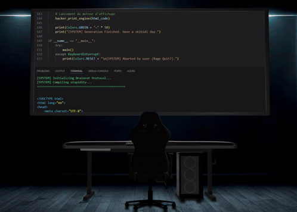

  

## <picture></picture> **About me**

<picture> </picture>

- 🔭 I’m currently building personal projects focused on Full Stack Development and AI
- 🌱 I’m continuously learning Software Architecture, Clean Code, SOLID principles, Design Patterns and DevOps.
- 👯 I’m looking to collaborate on your open source projects
- 🧠 I’m interested in Backend Engineering, Microservices, REST APIs and scalable software solutions
- 💬 Ask me about Continuous Improvement
- 🛠️ I enjoy exploring new technologies and applying AI throughout the software development lifecycle
- 📫 Feel free to connect with me for collaboration, networking or exciting opportunities
- 😄 Pronouns: Alejo88
- ⚡ Fun fact: QA testers are my biggest challenge... and my best teachers!

  

##  My Skills

| **Category** | **Technologies & Tools** |
|---|---|
| **Programming Languages** |  |
| **Frontend Development** |  |
| **Backend Development** |  |
| **Mobile Development** |  |
| **Databases** |  |
| **Artificial Intelligence & Machine Learning** |  |
| **Testing & Quality Assurance** |  |
| **DevOps & Cloud** |  |
| **Tools & Platforms** |  |
| **Version Control & Project Management** |  |

  

## Some Projects

  
  

  
  

  <a href="https://portfolio-web-alejo.vercel.app/">🌐 Portfolio</a> •
  <a href="https://github.com/Ale8Daniel8Armas?tab=repositories">📂 All Repositories</a>

  

### <h2>⚙️ Github stats:</h2> 

  
  

  

  

  

# Contact Me :

  

Let's connect! 👋

I'm always open to connecting with developers, collaborating on interesting projects, sharing ideas, and exploring new opportunities.

Whether you want to discuss software development, AI, technology, or simply exchange knowledge, feel free to reach out!

 

 
